# Guía de uso — Un Kilo Más (panel)

Manual del panel de entrenadores. Las capturas son de la app corriendo en local (`http://localhost:3000`) después de esta ronda: breadcrumbs, prescripción sin «@», íconos en el editor, panel de ejercicio a pantalla completa en móvil y selector de ejercicios por patrón.

Entras con la cuenta de entrenador que ya usas (no hace falta una cuenta nueva). El primer clic en **Entrar** deja la pantalla borrosa con **cargando** y te lleva al panel.

---

## Cómo se lee esta guía

- **Panel** es lo que ven Fred y Yohan (y Alfredo mientras prueba).
- **Vista de cliente** es una simulación de lo que ve la persona entrenada. No cambia sus datos salvo que registres series en un cliente demo.
- Todo lo marcado **Demo / prueba** es material de prueba. No es un cliente real.

---

## Permisos (Fred y Yohan iguales)

Los dos entrenadores pueden **editar, confirmar y publicar**. No hay diferencia de permisos.

Las etiquetas naranjas («revisar», «Falta prescripción», «Falta descripción») son **solo informativas**:

| Marca | Qué falta | Quién lo llena | Si nadie lo llena |
| --- | --- | --- | --- |
| **Falta prescripción** | Series y repeticiones de ese ejercicio | Fred o Yohan, en el constructor | El cliente no ve un texto inventado; ve que aún no hay prescripción |
| **Falta descripción** | Texto de la fase o del programa | Fred o Yohan, en Ruta +1 / Prueba | El cliente no ve esa marca |
| **Falta el foco** | Músculos o propósito del día | Fred o Yohan, campo «Foco del día» | El cliente no ve la marca |
| **revisar** | El ejercicio principal sigue pendiente de revisión | Fred o Yohan quitan la casilla «Marcar revisar» | No bloquea editar ni **Publicar fase** |

Antes decía «Pendiente de Yohan». Eso ya no significa «solo Yohan puede llenarlo». Quien esté en el panel puede completarlo.

**Publicar fase** funciona aunque queden marcas. En Remate, que ya está publicada, no aparece el botón; en las fases en borrador (Prueba) sí.

---

## Loader único

Cualquier clic que carga algo (login, pestañas, **Abrir**, **Guardar**, **Borrador**, **Copiar a todas las semanas**, **Publicar fase**, cambio de día, **Correos de la landing**, **Registrar series**) muestra al instante la pantalla **borrosa** con la palabra **cargando**. Se queda **mínimo 1 segundo**, aunque la carga sea más rápida, para que no parpadee.

No hay otro estilo de espera: ni spinner solo, ni barra sola, ni espera en silencio.

---

## Migas de pan (breadcrumbs)

En todas las páginas del panel, debajo del menú, aparece el recorrido **Panel › …**. El nivel actual no es un enlace. Pulsar un nivel anterior te lleva ahí. También en móvil.

Ejemplos:

- `Panel › Clientes › Demo Prueba`
- `Panel › Ruta +1 › Remate`
- `Panel › Pagos`

---

## Clientes

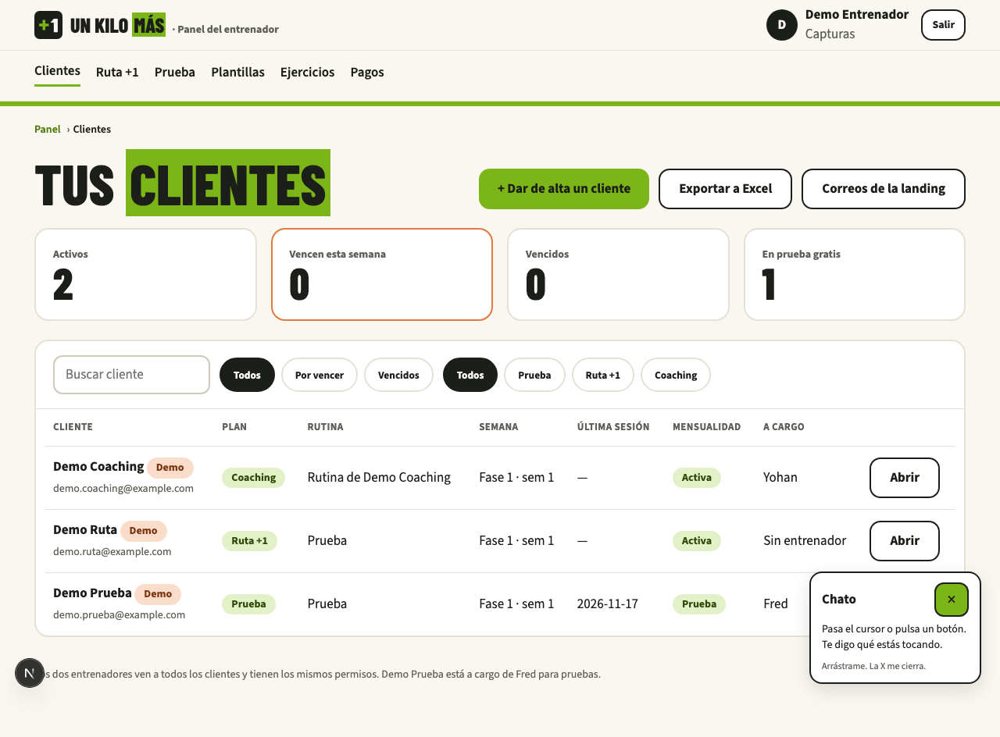

**Para qué sirve.** Ver a todas las personas, su plan, rutina, última sesión y quién las tiene a cargo.

**Cómo se usa.**

1. Menú **Clientes** (o entra al panel: cae aquí).
2. La búsqueda está aparte (con X para limpiarla). Debajo, **Estado** y **Plan** son grupos con su etiqueta. Al pulsar una píldora aparece «cargando» al instante. Si el filtro no coincide con nadie, el aviso lo dice y ofrece limpiar.
3. **Abrir** entra a la ficha.
4. **+ Dar de alta un cliente** da de alta a alguien nuevo.
5. **Correos de la landing** abre los leads.

Los dos entrenadores ven la lista completa. **Demo Prueba** está a cargo de **Fred**, con última sesión y la etiqueta **Demo**.

---

## Ficha de un cliente

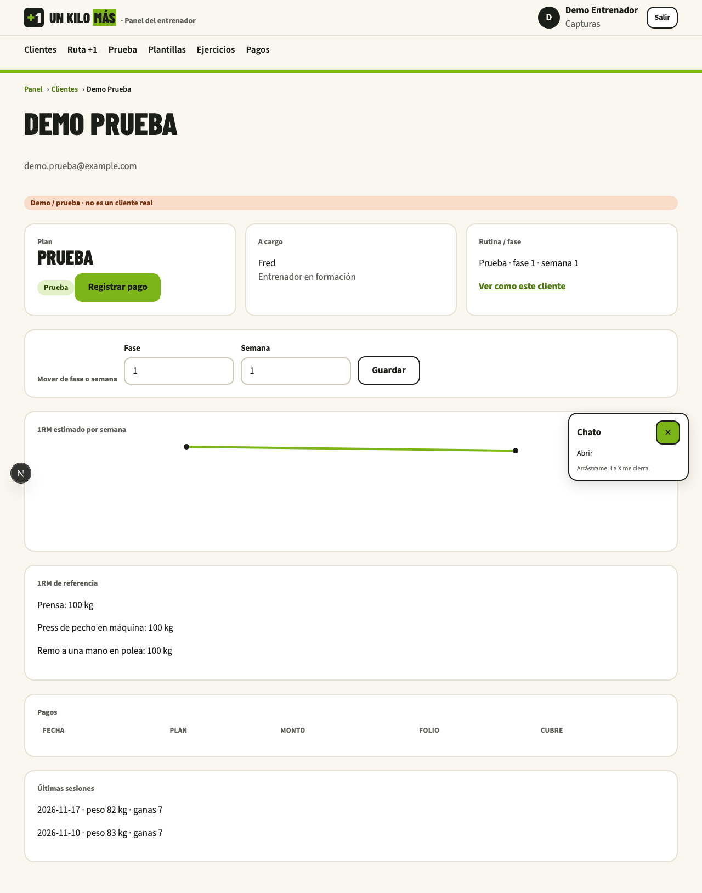

**Para qué sirve.** Ver el progreso de esa persona: plan, entrenador a cargo, gráfica de 1RM, kilos de referencia, pagos y sesiones.

**Cómo se usa (con el cliente demo de Fred).**

1. En Clientes, **Abrir** en la fila **Demo Prueba**.
2. Comprueba **A cargo: Fred** y la cinta **Demo / prueba · no es un cliente real**.
3. La gráfica **1RM estimado por semana** y **Últimas sesiones** usan las series demo (cargas y fechas).
4. **Ver como este cliente** abre la vista de cliente **con los datos de Demo Prueba**, no una rutina vacía.
5. **Registrar pago** anota un pago de esa persona.
6. Las migas `Panel › Clientes › Demo Prueba` te sacan de vuelta a la lista.

En **Pagos** de la ficha, si no hay monto se lee **Sin monto**; si no hay folio, **Sin folio**. Nunca un guion «—».

---

## Vista de cliente

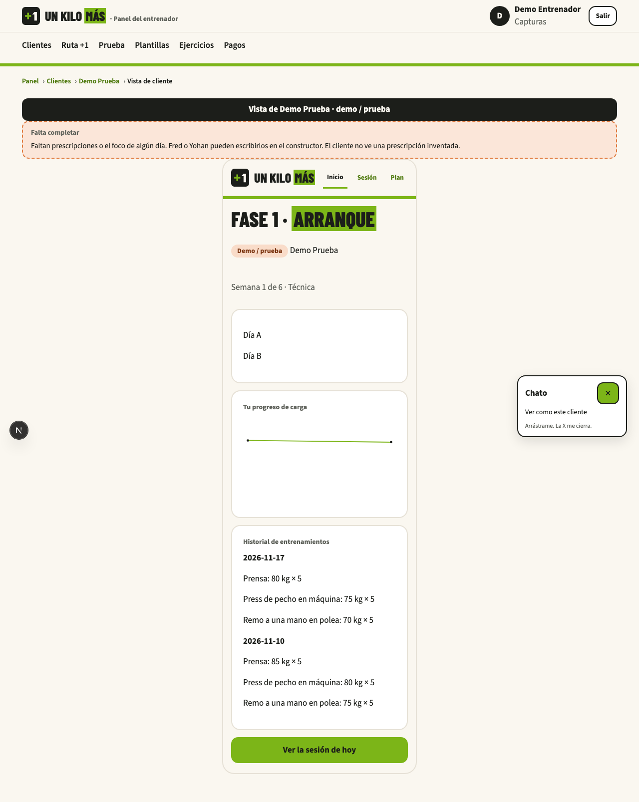

**Para qué sirve.** Ver la app como la ve esa persona: inicio (días, gráfica, historial), sesión de hoy y plan.

**Cómo se usa.**

1. Desde la ficha, **Ver como este cliente**, o desde una fase, **Ver como cliente**.
2. En **Inicio** ves el historial y la gráfica de cargas de **ese** cliente (en el demo: Prensa, press de pecho, remo, etc.).
3. En **Sesión** ves los ejercicios del día. La prescripción se lee igual que en el editor: **8 × 2** y pastilla **75 % 1RM**, sin «@».
4. Si un accesorio aún no tiene series/reps de Yohan, el cliente ve «Todavía no hay prescripción para este ejercicio», **no** un texto vago tipo «igual que el primero del bloque».
5. **Registrar series** (en el demo) guarda kilos y reps y los refleja en la gráfica.

---

## Ruta +1

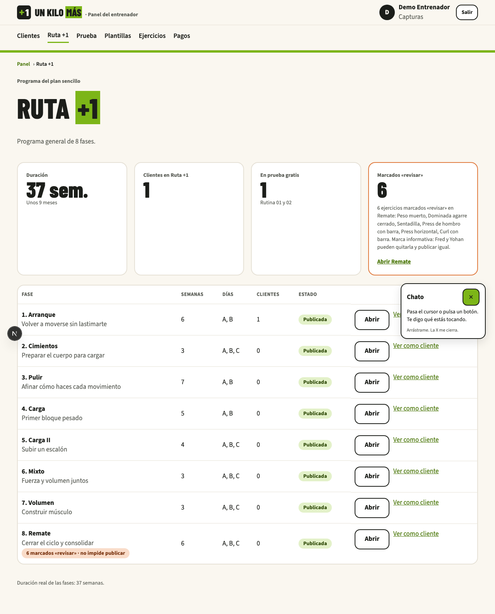

**Para qué sirve.** Las 8 fases del plan sencillo (Arranque → Remate).

**Cómo se usa.**

1. Menú **Ruta +1**.
2. La tarjeta naranja cuenta los ejercicios marcados «revisar» en Remate (hoy **6**, los mismos que en el constructor).
3. **Abrir** entra al editor de esa fase.
4. **Ver como cliente** muestra esa fase como la vería un cliente.
5. **Publicar fase** aparece solo si la fase sigue en borrador. Se puede pulsar con marcas pendientes.

No hay columna REVISAR llena de guiones. Si una fase no tiene descripción, la fila dice **Falta descripción · Fred o Yohan pueden escribirla**.

---

## Editor de rutinas (escritorio)

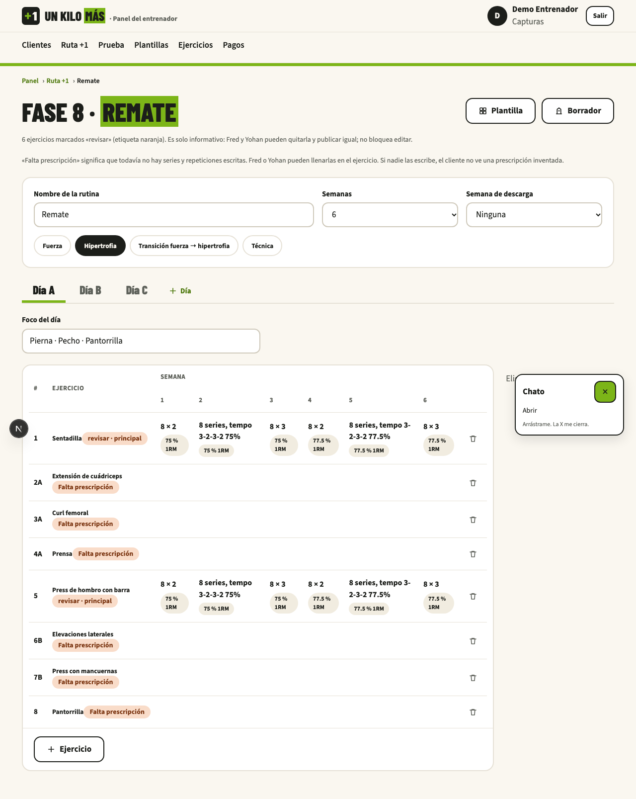

**Para qué sirve.** Armar días, ejercicios y la prescripción de cada semana.

**Cómo se usa.**

1. Desde Ruta +1, **Abrir** en Remate (o desde una plantilla / rutina de coaching).
2. Los días se llaman solo **Día A**, **Día B**, **Día C**. Los músculos van en **Foco del día** y en la lista, no en el botón.
3. Encima de las columnas de semana hay **una** etiqueta **Semana**; cada columna es el número **1 … 6**, sin repetir «SEM».
4. Cada celda muestra **series × reps** como valor principal y **75 % 1RM** como pastilla. No hay «@».
5. El bote de basura (sin borde) borra la fila; pide confirmación.
6. **Plantilla** guarda una copia como plantilla de coaching. **Borrador** guarda el meta.
7. **+ Día** y **+ Ejercicio** añaden con ícono + texto corto.
8. Al cambiar de día, el loader único cubre el cambio **mínimo 1 segundo**.
9. Toda la fila del ejercicio es clicable (nombre, semanas, número). El cursor es pointer y la fila cambia de fondo al pasar el mouse. El lápiz abre el mismo panel (tooltip «Editar ejercicio»). La papelera solo borra, con confirmación.
10. El panel «Editando el ejercicio» flota sobre un fondo difuminado y la página de detrás no se mueve. En el teléfono llena la pantalla. En escritorio queda centrado, de hasta 720 px de ancho. La X cierra y los cambios ya quedaron guardados. Los campos se desplazan dentro del recuadro. El editor de la biblioteca de ejercicios usa el mismo recuadro, con X y el botón Guardar adentro.

### Selector de ejercicios

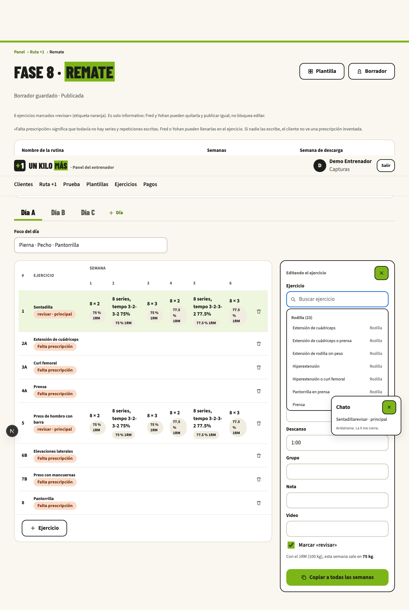

1. Pulsa un ejercicio de la tabla (o el campo **Buscar ejercicio** en el panel derecho).
2. Escribe: la lista se filtra al instante por nombre.
3. Los ejercicios van agrupados por **patrón** (Empuje, Jalón, Bisagra, Rodilla, Accesorio) con su conteo.
4. Al editar, el grupo del patrón actual sale **primero** (una sentadilla no se cambia por una dominada).

---

## Editor en el teléfono

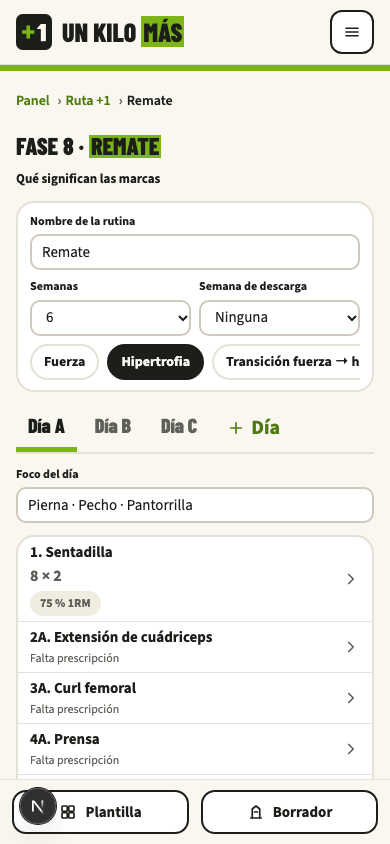

En móvil el menú es el ícono **☰**. **Plantilla** y **Borrador** van en la barra inferior, en una sola línea, con ícono + texto corto. **+ Día** y **+ Ejercicio** igual. Las pastillas Fuerza / Hipertrofia / Transición / Técnica se quedan con su texto porque el texto **es** la información.

Las marcas largas van plegadas en **Qué significan las marcas**. Los campos caben sin tapar el último con la barra de guardar: hay espacio inferior y más de tres ejercicios visibles.

### Panel «editando el ejercicio»

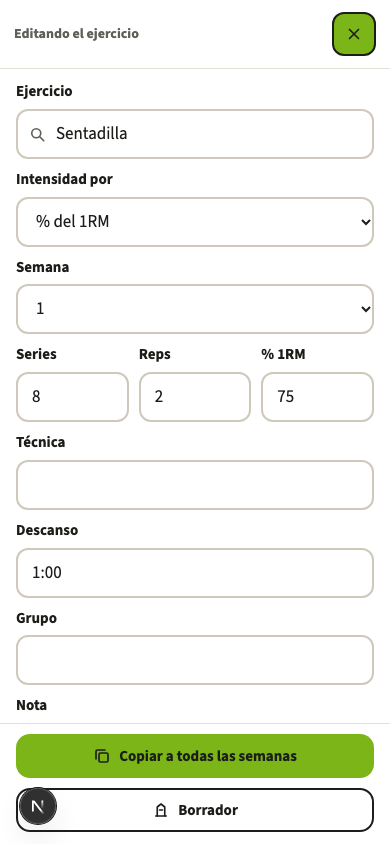

1. Pulsa una fila (lleva una flecha ›).
2. El panel llena **toda** la pantalla. El fondo queda difuminado y la página de detrás no se desplaza.
3. La **X** de la esquina cierra (sustituye al botón «Cerrar» de ancho completo).
4. **Copiar a todas las semanas** y **Borrador** quedan dentro del panel, visibles, no tapados.
5. **Descanso** y el resto de campos se ven al abrir; si hay muchos, se desplazan **dentro** del panel.

---

## Prueba

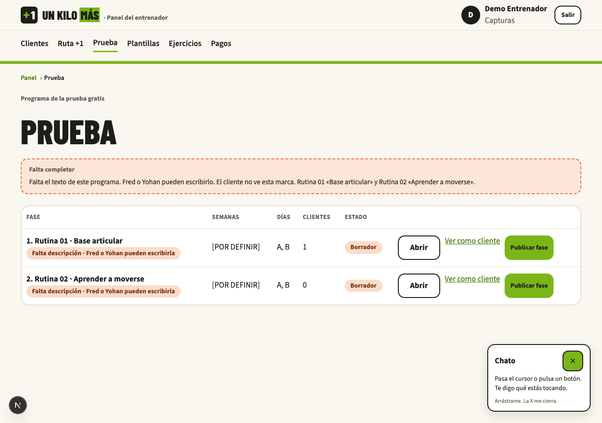

**Para qué sirve.** Las dos rutinas de la prueba gratis (Rutina 01 y 02).

**Cómo se usa.**

1. Menú **Prueba**.
2. Si falta el texto del programa, el aviso **Falta completar** dice qué falta y que Fred o Yohan pueden escribirlo.
3. **Abrir** entra al editor. **Publicar fase** publica esa rutina (también con confirmaciones pendientes).

Las semanas sin dato dicen **[POR DEFINIR]**, no un guion.

---

## Plantillas

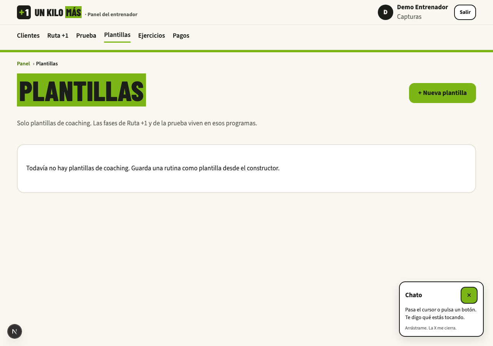

**Para qué sirve.** Guardar rutinas de **coaching** para reutilizarlas. Las fases de Ruta +1 y de la prueba viven en esos programas, no aquí.

**Cómo se usa.**

1. Menú **Plantillas**.
2. **+ Nueva plantilla** crea una vacía, o desde el editor pulsa **Plantilla**.
3. **Abrir** entra al mismo constructor.

---

## Ejercicios

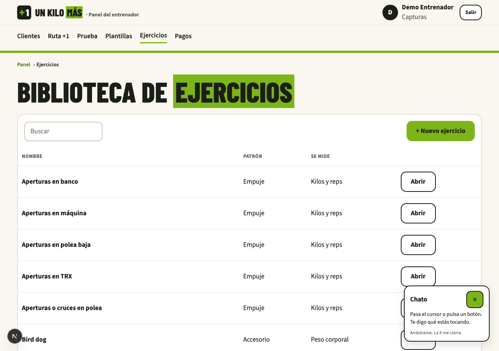

**Para qué sirve.** Los 121 ejercicios del catálogo, con patrón (Empuje, Jalón, Bisagra, Rodilla, Accesorio) y cómo se miden.

**Cómo se usa.**

1. Menú **Ejercicios**.
2. Busca por nombre.
3. **+ Nuevo ejercicio** agrega uno al catálogo.
4. **Abrir** edita nombre, patrón y alternativas.

Este catálogo es el que usa el selector del constructor.

---

## Pagos

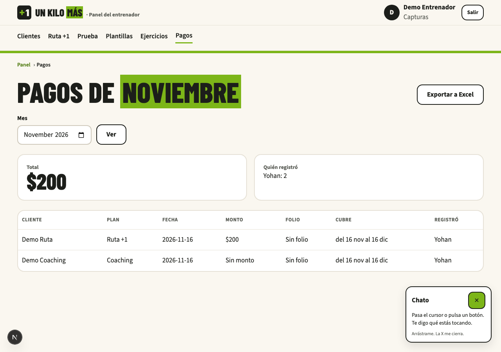

**Para qué sirve.** Ver lo cobrado del mes, quién lo registró, monto y folio.

**Cómo se usa.**

1. Menú **Pagos**.
2. Elige el mes y **Ver**.
3. **Sin monto** / **Sin folio** cuando no hay dato (nunca «—»).
4. El mismo criterio se usa en la ficha del cliente.
5. **Exportar a Excel** baja la tabla del mes.

---

## Correos de la landing

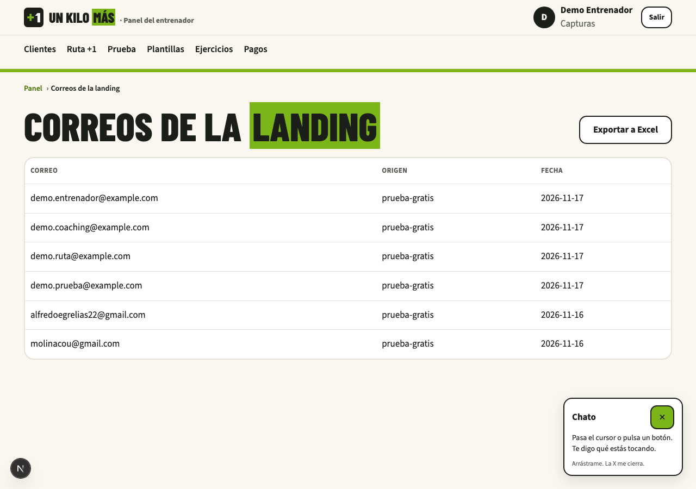

**Para qué sirve.** Ver quién dejó el correo en la landing de prueba gratis.

**Cómo se usa.**

1. Desde Clientes, **Correos de la landing**, o ve a `/panel/leads`.
2. La tabla carga al instante (con el loader único).
3. **Exportar a Excel** si hay que llevársela.

---

## Chato

La píldora negra de Chato ya no aparece. Nombraba el botón bajo el cursor y el clic no llevaba a ninguna página.

---

## Atajos de verificación rápida

| Quiero comprobar | Dónde |
| --- | --- |
| Cliente de Fred con gráfica y sesiones | Clientes → Demo Prueba |
| Vista de cliente con esas cargas | Ficha → Ver como este cliente |
| Días sin músculos, Semana 1–6, bote de basura, 8 × 2 | Ruta +1 → Remate |
| Selector con lupa y grupos | En Remate, pulsa Sentadilla y escribe en Buscar ejercicio |
| Panel a pantalla completa | El mismo editor en el teléfono |
| Publicar con marcas pendientes | Prueba → Publicar fase |
| Sin «—» en monto/folio | Pagos y ficha de Demo Coaching |
| Conteo «revisar» = 6 | Tarjeta naranja de Ruta +1 y leyenda del editor de Remate |
| Loader de 1 s | Cualquier pestaña o cambio de Día A → Día B |
